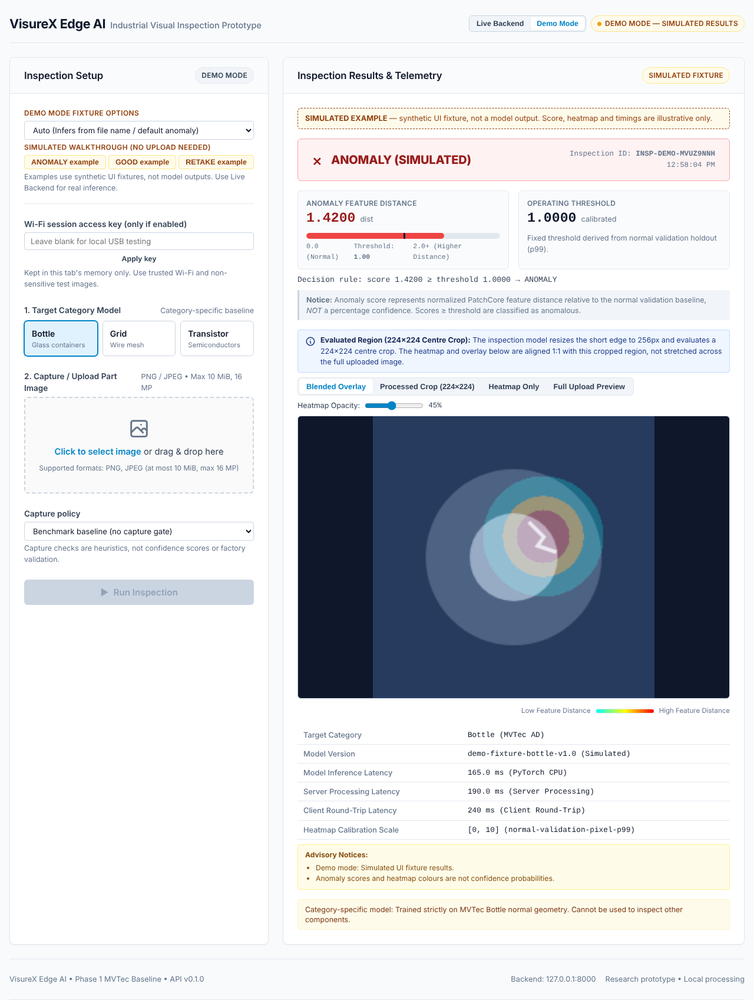
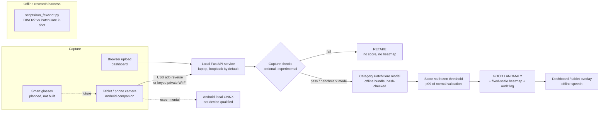

# VisureX Edge AI

Prototype · work in progress (Oct–Dec 2026)

Built at WCTE (Walmart Centre for Tech Excellence) · Wadhwani School of Data Science & AI · IIT Madras

A research prototype for visual inspection: build a normal-part reference bank,
check a new photo, and show the score, threshold and heatmap. The browser demo
uses DINOv2 features and eight references **plus separate normal calibration
photos**. Generated examples are available; owned-part photos and factory
qualification are pending.

**Live demo:** not deployed. A preview-only deployment was blocked by Vercel's
first-deployment Production requirement. No public site or pilot is claimed.
See [hosting status](docs/step1/preview.json),
[browser demo instructions](deploy/onboarding/README.md) and
[sample capture plan](CAPTURE_SAMPLES.md).

## Evidence and ownership

| Completed work | Evidence |
|---|---|
| Few-shot comparison: 15 categories, three seeds | [All results, intervals and limits](docs/sprint/S2_RESULTS.md) |
| DINOv2 k=8 macro AUROC 0.9560 [0.9267, 0.9814], versus PatchCore 0.9242 [0.8684, 0.9682] | [Source measurements](docs/sprint/S2_RESULTS/summary.json); category-bootstrap 95% CIs |
| Browser/Python decision parity on 20 generated checks; warm browser timing and CIs | [Export and parity record](docs/step1/browser_parity.json) |
| Capture check, including its earlier blur failure | [Stress study](docs/results/SOFTWARE_AND_STRESS_2026-10-22.md) |
| Locally verified onboarding demo | [Milestone report](MILESTONE_REPORT_STEP1.md) |
| Rejected normal-only router | [Negative result](docs/sprint/S3_RESULTS.md) |

**Inherited:** WCTE's PatchCore-based VisureX pipeline, built on the established
[PatchCore method](https://arxiv.org/abs/2106.08265) (Roth et al., CVPR 2022).
**My work:** audit and benchmark harness, few-shot comparison/analysis,
export/parity workflow, capture checks, and web/Android prototype engineering.
Physical-device and glasses qualification remain pending.

The DINOv2 patch-neighbour baseline follows
[AnomalyDINO](https://arxiv.org/abs/2405.14529) (Damm et al., WACV 2025;
[official code](https://github.com/dammsi/AnomalyDINO)). It is benchmarked/adapted
and studied here, not a new detection method or exact paper-result reproduction.
The existing [Apache-2.0 licence](LICENSE) matches upstream's `LICENSE`;
upstream attribution is retained in [NOTICE](NOTICE).

Next: blur/lighting robustness, real phone/glasses captures, inspector interviews
and a pilot. These are planned, with no user adoption or factory impact claimed.

## Local benchmark application

**What:** a research prototype that flags visually anomalous parts from a photo and
shows *where* with a heatmap, while refusing to judge unusable captures (RETAKE).
**Who:** quality inspectors at Indian MSMEs (small and medium manufacturers) that cannot
afford fixed machine-vision cells, developed with the Walmart Center for Tech Excellence
(WCTE) at IIT Madras. **Why:** manual visual inspection is slow and inconsistent, and
defective images are scarce, so the detector learns only from normal parts.
**Roadmap:** laptop + phone/tablet camera now → smart camera on the line → hands-free
capture and spoken feedback on smart glasses, each step behind a measured go/no-go gate.

> Honest status: the detector is the inherited WCTE PatchCore pipeline, validated on
> 3 MVTec AD benchmark categories with CPU timings. It is **not** factory-validated,
> no physical tablet, Android-local or Meta glasses run has been measured yet, and
> synthetic blur makes it flag every image (see below).

> New research results: [few-shot benchmark report](docs/results/FEWSHOT_2026-10-30.md). Outcomes are mixed; the registered broad-success criteria were not met. Additional baseline evidence is in [the build report](07_build_walmart.md).

## Demo

The new [eight-reference browser onboarding demo](deploy/onboarding/README.md)
benchmarks and adapts established [AnomalyDINO](https://arxiv.org/abs/2405.14529)
([official code](https://github.com/dammsi/AnomalyDINO)) and
[PatchCore](https://arxiv.org/abs/2106.08265). It is not a new detection method.
It uses generated samples until owner photos arrive, and requires eight bank
photos **plus separate normal calibration**. See [Step 1 evidence](docs/step1/)
for measured browser parity/timing and deployment status.

Screenshots from the browser dashboard in **Demo Mode**, captured with Playwright at
1280 px and 390 px. Every value in them is a **simulated UI fixture**, labelled as such
in the UI, not a model output. Also: [RETAKE example](docs/images/demo-retake-desktop.png),
[phone width](docs/images/demo-anomaly-mobile.png). Live Mode shows real scores from the
local backend (see [Phase 2 verification](docs/results/PHASE2_COMPLETE_2026-10-21.md)).

Try it without models: `cd frontend-prototype && python -m http.server 8080`, then open
`http://localhost:8080/?mode=demo`.

## Results so far (Phase 1, MVTec AD, CPU)

Copied from [`docs/results/PHASE1_RESULTS_2026-10-21.md`](docs/results/PHASE1_RESULTS_2026-10-21.md);
threshold fixed at the 99th percentile of normal validation scores, never tuned on test.

| Category | Train / validation | Test normal / anomaly | Image AUROC | TP / FP / TN / FN | Defect recall | Normal false-alarm rate | Median / p95 inference |
|---|---:|---:|---:|---|---:|---:|---|
| Bottle | 167 / 42 | 20 / 63 | 1.0000 | 63 / 1 / 19 / 0 | 100% | 5.00% | 165 / 198 ms |
| Grid | 211 / 53 | 21 / 57 | 0.9883 | 53 / 1 / 20 / 4 | 92.98% | 4.76% | 174 / 226 ms |
| Transistor | 170 / 43 | 60 / 40 | 0.9983 | 39 / 3 / 57 / 1 | 97.50% | 5.00% | 144 / 188 ms |

Timings are CPU model calls (batch 1, four threads) after model load, not
camera-to-answer latency. Three categories of an external benchmark, one backbone,
one seed: this is a feasibility gate, not an industrial reliability claim. A synthetic
capture stress test ([`SOFTWARE_AND_STRESS_2026-10-22.md`](docs/results/SOFTWARE_AND_STRESS_2026-10-22.md))
found that Gaussian blur makes the detector flag 100% of normal images, which is why
the experimental RETAKE capture checks exist and why they are not yet a reliable gate.

## Phases and go/no-go gates

| Phase | Scope | Gate | Status |
|---|---|---|---|
| 0. Intake audit | Inventory inherited code/data; leakage checks | Trustworthy baseline possible? | Done: found top-view train/test duplicates and a validation loader reading `test/good`; baseline moved to MVTec AD |
| 1. Feasibility | Fresh PatchCore runs on bottle, grid, transistor | 3-category integration gate | **Controlled go-ahead** (21 Oct 2026) |
| 2. Local web prototype | FastAPI + browser dashboard, real inference, fixed-scale heatmaps | Real-model parity in UI | Complete (21 Oct 2026) |
| 3. Software expansion | Offline bundles, RETAKE checks, Android companion source, Wi-Fi mode, CI | 261/261 decision parity offline | Parity passed; blur failure documented |
| 4. Device qualification | Physical tablet: USB/Wi-Fi, latency, memory, Android-local ONNX | Measured on the actual device | **Not started** |
| 5. Real capture study | Consented WCT parts, grouped splits, frozen thresholds | Recall / false alarms / retake burden on untouched captures | **Not started** ([protocol](docs/RESEARCH_AND_FIELD_PROTOCOL.md)) |
| 6. Smart glasses | Supported Meta SDK capture and audio | Official SDK access + hardware test | **Not started** |
| R. Few-shot research | DINOv2 vs PatchCore with k = 1–16 normal images | Pre-registered success criteria | Measured comparison complete; mixed results ([report](docs/results/FEWSHOT_2026-10-30.md), [protocol](docs/FEWSHOT_PROTOCOL.md)) |

## Architecture

## How to run

- Backend + dashboard with local models: [`backend/README.md`](backend/README.md) and
  [`docs/SOFTWARE_HANDOVER.md`](docs/SOFTWARE_HANDOVER.md).
- Frontend only (Demo Mode, simulated): see above.
- Tests as CI runs them: [`.github/workflows/software-checks.yml`](.github/workflows/software-checks.yml)
  (`python -m pytest backend/... scripts/test_*.py -q` and `node scripts/test_frontend.mjs`).
- Few-shot benchmark (owner runs; needs MVTec AD and model downloads):
  `python scripts/run_fewshot.py --data-root data/raw/mvtec_ad --output artifacts/fewshot-run1`
  or [`notebooks/fewshot_colab.ipynb`](notebooks/fewshot_colab.ipynb).
- Design note for an optional VLM-written operator instruction that never makes the
  decision: [`docs/VLM_EXPLANATION_DESIGN.md`](docs/VLM_EXPLANATION_DESIGN.md).

---

## Current status

Private Wi-Fi support and an experimental on-device Android ONNX mode are now
implemented. The portable graphs match all 261 reference decisions on the laptop;
physical Android inference, memory use and image-level preprocessing agreement
still need testing. See [phone testing](docs/WIFI_AND_OFFLINE_TESTING.md).

The 22 October software expansion adds verified offline model bundles,
experimental capture checks with a separate RETAKE outcome, an Android
phone/tablet companion, dataset-group validation and CI checks. See
[software handover](docs/SOFTWARE_HANDOVER.md) and the
[research/field protocol](docs/RESEARCH_AND_FIELD_PROTOCOL.md).
The companion defaults to laptop inference through USB; experimental local CPU
inference is a separate option. Physical-device testing and Meta integration
remain separate gates.

Phase 2 is complete as a local web inspection prototype: real model inference,
fixed-scale heatmaps, upload validation, metadata logs and explicit Live/Demo
modes. See [Phase 2 verification](docs/results/PHASE2_COMPLETE_2026-10-21.md).
Start with `backend/README.md`. Next is the Android companion prototype;
phone-local inference and real glasses capture are not yet validated.

Phase 1 now has fresh CPU results on MVTec AD bottle, grid and transistor,
including dataset checks and saved-model inference verification. The decision
is a controlled go-ahead for a laptop-backed integration prototype, not an
industrial reliability claim. See
[`docs/results/PHASE1_RESULTS_2026-10-21.md`](docs/results/PHASE1_RESULTS_2026-10-21.md).
The full 15-category benchmark remains later research work.

## Development sequence

1. Reproduce inference with the supplied model artifacts.
2. Make training and evaluation portable and configuration-driven.
3. Build capture-group-aware train, validation, and test splits.
4. Retrain and report trustworthy per-view metrics.
5. Add mobile-camera capture and edge inference.
6. Integrate the validated mobile pipeline with supported Meta glasses interfaces.

## Repository policy

Raw industrial datasets, inherited model binaries, credentials, and generated
model artifacts are not committed here. The authorized upstream implementation
is being made portable and independently maintained here together with its
configuration, validation scripts, evaluation code, and approved documentation.

