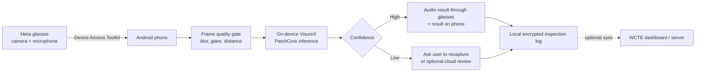

# VisureX validation and Meta glasses integration decision

**Status as of 16 October 2026**

## Recommendation

I recommend a **controlled go-ahead**. The MVTec bottle run is enough to show
that the VisureX anomaly-detection path is real and executable. It is not enough
to claim that the model is ready for deployment across different products or
factory conditions.

The sensible approach is to start the Meta glasses capture-and-audio loop now,
while validating the detector on a few more representative categories in
parallel. We should not wait for every research experiment before touching the
glasses, but we should also not present the present detector as production-ready.

| Question | Decision |
|---|---|
| Does the pipeline run end to end? | **Yes.** Training, calibration, inference, metrics, evidence export and model saving worked. |
| Is the earlier Top-view result trustworthy? | **No.** It had train-test duplication. |
| Is the new bottle result leakage-free? | **Yes for exact duplicates.** No exact train-test overlap was found. |
| Is one MVTec category enough to start integration? | **Yes, for a prototype.** |
| Is one category enough for a paper or general performance claim? | **No.** |
| Are all 15 categories compulsory immediately? | **No.** They are needed later for a proper benchmark. |
| Is a multi-backbone system compulsory? | **No.** One backbone is preferable for the first edge version. |

## What has been established

The smoke test used the MVTec AD `bottle` category, WideResNet-50, one seed and a
1% PatchCore coreset. The split contained 167 normal training images, 42 normal
validation images and 83 untouched test images. The test set had 63 anomalous
and 20 normal samples. Exact SHA-256 checking found no train-test duplicates.

| AUROC | F1 | Precision | Recall | TP | FP | TN | FN |
|---:|---:|---:|---:|---:|---:|---:|---:|---:|
| 1.0000 | 0.9921 | 0.9844 | 1.0000 | 63 | 1 | 19 | 0 |

This is a strong smoke-test result: all 63 anomalous bottle images were detected
and one normal image was incorrectly flagged. It proves that the inherited core
is not a hollow prototype. However, bottle is only one comparatively clean
object category. A perfect ranking on it does not prove performance on textures,
small defects, new components, motion blur, glare or a head-mounted camera.

MVTec AD contains **15 categories**, not 15 backbones. We tested one category
with one backbone. These are two different experiment axes.

| Evidence level | Minimum work | What we can say afterwards |
|---|---|---|
| Completed smoke test | Bottle, one backbone, one seed | “The pipeline works end to end on clean external data.” |
| Integration gate | 3 representative categories, one backbone | “The detector is stable enough to connect to the glasses prototype.” |
| Benchmark | All 15 categories, matched baseline | “We have measured general benchmark performance.” |
| Research claim | 15 categories, 3 seeds, ablations | “This VisureX addition improves accuracy, efficiency or robustness.” |

For the three-category gate, I would use `bottle` for an object, `carpet` for a
texture, and `transistor` or `metal_nut` for small structured defects. If these
runs complete without leakage or pipeline failures, glasses work can proceed
without waiting for multi-backbone ablations. The full 15-category experiment
can run later on Colab, Kaggle or the WCTE lab GPU.

## Proposed glasses architecture

Meta's Wearables Device Access Toolkit 1.0 supports Android and iOS mobile apps
and exposes camera, microphone, audio, motion and IMU capabilities. It also has
a Mock Device Kit, so development can begin before every hardware path is ready.
Ray-Ban Meta glasses are sold in India. Displayless Ray-Ban models can return the
result through their open-ear speakers; the detailed image and history remain on
the phone. Meta states that the glasses still pair through the Meta AI mobile
app. [Meta SDK and device FAQ](https://developers.meta.com/wearables/faq/),
[India availability](https://about.fb.com/news/2025/05/ray-ban-meta-glasses-come-to-india-experience-the-future-with-meta-ai-integrated-and-multiple-styles-on-offer/)

The first build should be **event-driven**, not continuous video inference. The
operator says “inspect”, the app captures a short burst, rejects blurred or
glare-heavy frames, selects the best frame and runs one local inference. This is
cheaper, easier on battery and easier to audit than uploading a continuous
factory video stream.

The present WideResNet model is acceptable for integration testing, but mobile
latency is still unmeasured. The edge version should eventually compare it with
a smaller backbone or a distilled/quantised model. Accuracy, latency, memory and
battery use must all be reported on the actual phone.

## Cost model

The Meta SDK is the device interface; it is not the anomaly-detection server.
Meta does not publish a per-camera-call charge in the cited SDK material. If the
model and logs remain on the phone, there is no inference-server bill. Costs
begin only when we add cloud storage, dashboards, remote model updates or a
cloud AI fallback.

Planning assumptions below: 50 inspections per operator per working day, 22
days per month, one compressed image per inspection, and ₹90 per US dollar.
These are engineering estimates, not vendor quotations.

| Architecture | 1 operator / month | 100 operators / month | Main trade-off |
|---|---:|---:|---|
| Phone-only inference, local logs | **₹0 server inference** | **₹0 server inference** | Lowest cost and strongest privacy; phone performance must be validated. |
| Phone inference + small backend for users, model versions and selected logs | ₹0–₹1,500 during prototype | Roughly ₹5,000–₹20,000 | Useful for fleet management; range depends on retention and support level. |
| Hybrid: local inference, Decisions/Jev review for 5% uncertain cases | Usually below ₹10 in model calls, plus backend | Roughly ₹100–₹1,000 in model calls, plus backend | Good fallback without uploading every frame. |
| OpenAI Decisions for every inspection | Roughly ₹10–₹50, plus backend | Roughly ₹1,000–₹5,000, plus backend | Very cheap typed decisions, but images leave the phone. |
| Jev vision for every inspection | Similar low token cost; benchmark the actual host | Likely low thousands of rupees or less, plus backend | Fast typed decisions; vision support and provider terms must be confirmed. |
| Dedicated cloud GPU running continuously | Unnecessary for the prototype | Commonly tens of thousands of rupees per month | Only justified by sustained volume or server-side models. |

The cloud ranges are budget estimates because image token counts depend on
resolution and detail. OpenAI's **Decisions API** is a real beta endpoint. It
accepts text and images, returns a predicate probability, a fixed choice or a
rubric score, and is documented as roughly 10× faster than the Responses API.
It currently uses `gpt-6-luna` and costs $0.10 per million input tokens, with no
output-token charge. Under the planning load above, the model charge is small;
the backend, networking, logging and operational support may cost more than the
decisions themselves. [OpenAI Decisions API](https://developers.openai.com/api/docs/guides/decisions),
[API reference](https://developers.openai.com/api/reference/resources/decisions/methods/create)

Continuous streaming should be avoided. A 2 Mbps stream used for eight hours a
day is about 158 GB per operator per month, before protocol overhead. Event-based
still images reduce bandwidth by orders of magnitude and make the inspection
record easier to review.

## Jev and OpenAI Decisions: where they fit

Jev is TypeSafe AI's fast **System One** decision model. Instead of generating
an explanation, it answers constrained questions such as yes/no (`noul`), one
choice from supplied labels, or a score, together with probabilities. Jev 1.14
documentation also describes experimental PNG/JPEG input and bounding-box
output. Published Jev access routes and versions do not all have identical
vision support or pricing, so the exact provider endpoint must be fixed before
we report cost or latency. A widely available Jev 1.13 listing prices text input
at $0.042 per million tokens with free output.
[Jev API documentation](https://jevmodel.org/docs/),
[Cloudflare Jev listing](https://developers.cloudflare.com/ai/models/typesafe/jev/)

OpenAI's Decisions API solves a similar problem using `gpt-6-luna`. Unlike my
earlier interpretation, it is not the normal Responses API with structured JSON
added afterward. It has its own `POST /v1/decisions` endpoint, accepts images
directly, and can return a damage probability, a defect-type choice and a
severity score in one request.

| Component | Best role in this project | Recommendation now |
|---|---|---|
| PatchCore / VisureX | Fast part-specific anomaly score from normal training images | **Primary local baseline** |
| Small frame-quality model | Reject blur, glare, bad angle and excessive distance | **Build into the first mobile prototype** |
| Jev vision | Fast cloud yes/no, defect class or severity decision | Challenger after confirming the exact vision endpoint |
| OpenAI Decisions | Fast image predicates, choices and scores | **Benchmark now as the cloud challenger** |

These APIs could make the first general demo much faster because they need no
part-specific PatchCore training. That does not make them automatically more
accurate. Small scratches, tolerances and rare surface defects may not be
represented well in a general model. Their probabilities also need calibration
on labelled industrial images. The right experiment is to give PatchCore, Jev
and OpenAI Decisions the same test images and compare AUROC, precision, recall,
latency and cost. Until that comparison is complete, the safer path is:

**local PatchCore → confidence check → Jev/OpenAI decision for uncertain cases → human review for critical cases.**

## Immediate execution plan

1. Run the three-category single-backbone gate. Multi-backbone work can wait.
2. On the same images, run Jev vision and OpenAI Decisions using fixed questions:
   defect present, defect type and severity. Record accuracy, latency and cost.
3. Build the Android app against Meta's Mock Device Kit: connect, capture, send
   a frame into a placeholder detector and return an audio response.
4. Export the current detector to an Android-compatible runtime and measure
   latency, memory and battery use on the paired phone.
5. Test with real glasses using one controlled component and fixed capture
   instructions. Collect failures caused by blur, angle, lighting and glare.
6. Run the complete 15-category benchmark and backbone ablations on GPU for the
   thesis/paper, without blocking the integration prototype.

This keeps the project safe without making it slow: the glasses interface can
start now, the detector receives one additional validation gate, and any claim
of general performance waits for the complete benchmark.
